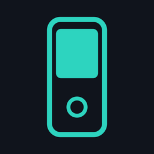
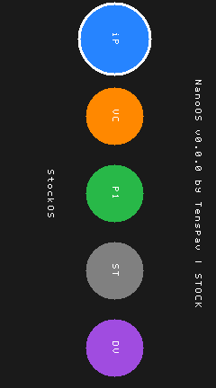
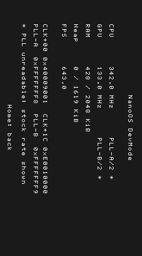
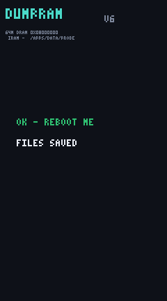

<p align="center">
  
</p>

<h1 align="center">NanoOS</h1>

<p align="center">
  A custom, bare-metal launcher and OS layer for the <b>iPod nano 7th generation</b> (2012).<br>
  Runs alongside the stock iPod OS. No NAND modification required.
</p>

<p align="center">
  
  
  
</p>

---

## What is NanoOS?

NanoOS is a tiny custom operating system that boots on a jailbroken iPod nano 7G. It is loaded from the stock iPod OS through a homebrew app called **NanoOS Loader**, performs a warm hardware handoff, and runs in bare-metal ARM mode with full control of the CPU, GPU, and RAM.

It is the first step toward running homebrew games and apps outside of Apple's RetailOS, without dual-booting and without touching the NAND flash.

## Why it matters

The iPod nano 7G is a powerful little device hiding inside a music-player body:

| | |
|---|---|
| **SoC** | Samsung S5L8747, ARM Cortex-A5 @ up to 684 MHz |
| **RAM** | 64 MB DRAM (40 MB usable by apps) |
| **GPU** | PowerVR MBX Lite, unlockable to 266 MHz |
| **Display** | 240 x 432 @ 60 Hz |
| **Storage** | 16 GB NAND flash |
| **Wireless** | Bluetooth classic + BLE, FM radio |

Until now, homebrew ran as apps inside RetailOS, limited to the OS heap and Apple's UI sandbox. NanoOS breaks out of that sandbox and gives homebrew direct hardware access, unlocking the full performance of the device.

## What it does today

- Boots from RetailOS through a homebrew loader icon on the home screen.
- Shows a horizontal game/app launcher.
- Lets you pick a clock profile: **STOCK**, **SAFE**, or **MAX**.
- Includes a live **devmode** screen showing CPU clock, GPU clock, RAM usage, and FPS.
- Returns safely to the stock iPod OS by selecting **StockOS**.

<p align="center">
  
  
  
</p>

## Current progress

| Feature | Status |
|---|---|
| Boot from RetailOS | Done |
| Warm hardware handoff | Done |
| Launcher UI | Done |
| Clock profile selector | Done |
| Return to RetailOS | Done |
| Devmode (CPU/GPU/RAM/FPS) | Done |
| Load external game binaries | In research |
| NAND driver for standalone apps | In research |
| Audio driver | In research |
| Bluetooth driver inside NanoOS | In research |

## Future plans

1. **Game launcher** — boot ViceNano, emulators, and homebrew directly from NanoOS.
2. **Full hardware drivers** — LCD, touch, buttons, audio, NAND, GPU, Bluetooth.
3. **Standalone mode** — run games without going through RetailOS first.
4. **Handheld cradle** — 3D-printed case + Bluetooth gamepad + battery.

## Installation

### Requirements

- iPod nano 7th generation (2012)
- Untethered jailbreak (see [wInd3x](https://github.com/freemyipod/wInd3x) and the [NanoApps](https://github.com/freemyipod/nanoapps) SDK community)
- Linux computer with `sg3-utils` to drive the iPod over SCSI
- [NanoApps SDK](https://github.com/freemyipod/nanoapps) cloned next to this repo

### Repository layout

```
NanoOS/
  nanoos/         # NanoOS bare-metal kernel
  NanoOSLoader/   # RetailOS homebrew app that boots NanoOS
  assets/         # Screenshots and icon
  install.sh      # One-line installer
```

### One-line install

```sh
git clone https://github.com/tenspav/NanoOS.git
cd NanoOS
./install.sh
```

### Manual install

1. Build the NanoOS kernel:
   ```sh
   cd nanoos
   make
   ```

2. Build and package the NanoOS Loader app:
   ```sh
   cd ../NanoOSLoader
   ./package.sh
   ```

3. Copy the packaged app and kernel to the iPod:
   ```sh
   sudo cp -r /tmp/hbapps/Apps /mnt/ipod/
   ```

4. Reboot the iPod. The **NanoOS** icon appears on the home screen.

## Credits

- NanoOS is built on top of the jailbreak and homebrew work from the **wInd3x** and **NanoApps** communities.
- Hardware research powered by [NanoEmu](https://github.com/tenspav/NanoEmu).
- Device firmware remains the property of Apple Inc.

## Disclaimer

This is independent research and interoperability work on hardware owned by the user. It is not affiliated with Apple Inc. "iPod" is a trademark of Apple Inc.
