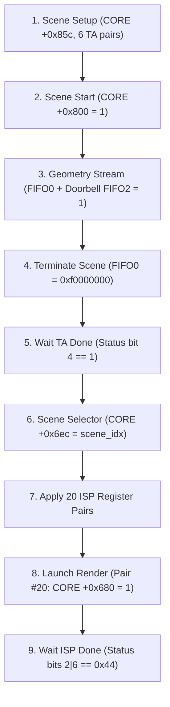

# PowerVR MBX Driver Developer Reference (Hardware Path)

This developer reference outlines the hardware driver architecture, register definitions, submission sequence, and buffer requirements for the PowerVR MBX graphics core in [NanoOS](file:///home/pavliukov/ipodwork/NanoRework/nanoos/). It synthesizes findings from [MBX_RETAILOS_RE.md](file:///home/pavliukov/ipodwork/NanoRework/nanoos/MBX_RETAILOS_RE.md) to enable true bare-metal rendering on user-owned hardware, moving beyond emulator-only shortcuts.

---

## 1. Architecture Overview

The PowerVR MBX is a **Tile-Based Deferred Rendering (TBDR)** accelerator split across two primary processing stages, a dedicated memory management unit, and streaming hardware queues:

* **Tiling Accelerator (TA)**:
  * Ingests state blocks, geometry primitives, and vertex coordinates via **FIFO0** (`0x3b800000`).
  * Projects geometry into tile-space, calculates bounding boxes, and writes sorted per-tile primitive lists into parameter RAM.
  * Driven by scene initiation at `+0x800` and terminated by EOL token `0xf0000000`.
* **Image Synthesis Processor (ISP / TSP)**:
  * Traverses per-tile primitive lists produced by the TA.
  * Performs on-chip Hidden Surface Removal (HSR) and texture/pixel shading per tile.
  * Writes rendered tiles directly back into the target framebuffer in DRAM.
  * Launched via register `+0x680` after setting up the 20-pair ISP render list.
* **GPU MMU**:
  * Translates GPU Virtual Addresses (VA) to physical DRAM pages.
  * Managed by 8 page table roots at `+0x1000..+0x101c` (each pointing to 1024 4-byte PTEs = 4 MB per table, 32 MB total).
  * Controlled via `+0x1020` (bit 0: enable, bit 8: invalidate, bit 16: status).
* **Command & Streaming FIFOs**:
  * **Core MMIO Base**: `0x3b000000` (window `0x4000`).
  * **FIFO0 (Geometry & Commands)**: `0x3b800000` (window `0x200000`, depth `0x7b` words).
  * **FIFO1**: `0x3ba00000`.
  * **FIFO2 (Segment Commit / Doorbell)**: `0x3bc00000` (write `1` to commit segment).
  * **FIFO Occupancy**: Monitored via core register `+0x12c[23:16]`.

---

## 2. Key MBX Register Reference

All register offsets are relative to core base `0x3b000000`.

| Phase | Offset | Name / Role | Observed Value | Purpose & Description |
|---|---|---|---|---|
| **Init** | `+0x080` | Reset Control | `0x111` / `0` | Core, TA, and TSP soft reset toggle with intermediate delays. |
| **Init** | `+0x130` | Interrupt Enable | `0x8775` (or `0`) | Hardware event IRQ mask (use `0` for pure polling in [`mbx_init`](file:///home/pavliukov/ipodwork/NanoRework/nanoos/src/mbx.h#L13)). |
| **Init / IRQ** | `+0x134` | Event Ack (W1C) | `0xffff` | Write-1-to-clear all pending status and completion flags. |
| **Init** | `+0x85c` | Clock / Core Config | `0x80` | Direct baseline clock gate configuration during cold setup. |
| **Init** | `+0x1000..+0x101c` | MMU Table Roots 0–7 | Physical PA array | 8 page table physical addresses mapping GPU VA to physical DRAM. |
| **Init** | `+0x1020` | MMU Control & Status | `0x101` | Bit 0: enable translation, bit 8: invalidate TLB, bit 16: ready status. |
| **Scene** | `+0x85c` | Scene Configuration | `0x00e068e1` | Tile grid dimensions and operating flags: `(desired & ~0x388) \| (CORE(0x85c) & 0x388) \| 0x80`. |
| **Scene** | `+0x840` | TA Parameter Base | `<ta_pb_base>` | GPU VA of allocated Parameter Buffer base (e.g. `0x002f0300`). |
| **Scene** | `+0x844` | Scene Buffer Pointer | `<scene_buf>` | Selected scene buffer GPU VA; must match ISP `+0x608` (e.g. `0x002f1304`). |
| **Scene** | `+0x84c` | Clip Width | `width << 16` | Screen width fixed-point clipping boundary (`240 << 16 = 0x00f00000`). |
| **Scene** | `+0x850` | Clip Height | `height << 16` | Screen height fixed-point clipping boundary (`432 << 16 = 0x01b00000`). |
| **Scene** | `+0x854` | Guardband Scale X | `0x3727c5ac` | Screen-space scale parameter (~`1e-5` IEEE single float). |
| **Scene** | `+0x858` | Guardband Scale Y | `0x3727c5ac` | Screen-space scale parameter (~`1e-5` IEEE single float). |
| **Scene** | `+0x800` | Scene Begin Kick | `1` | Starts the Tiling Accelerator scene ingestion. |
| **Render** | `+0x6ec` | Scene Selector | `<scene_idx>` | Selects active scene index (e.g. `0`); **must precede** the 20-pair list. |
| **Render** | `+0x608` | ISP Scene Buffer | `<scene_buf>` | Scene buffer pointer input for ISP; identical to TA `+0x844`. |
| **Render** | `+0x610` | ISP Config 0 | `0x00030000` | Core ISP operational modes. |
| **Render** | `+0x614` | ISP Parameter 1 | `0x1e3ce508` | Hardware pipeline constant. |
| **Render** | `+0x618` | ISP Parameter 2 | `0x1e3ce508` | Hardware pipeline constant. |
| **Render** | `+0x61c` | ISP Parameter 3 | `0x00020007` | Hardware pipeline constant. |
| **Render** | `+0x63c` | Clear Colour | ARGB word | Background clear colour (format reordered from context; `0` = black). |
| **Render** | `+0x644` | Aux Buffer Config | `0` | Auxiliary depth/stencil flag (`0` without aux buffer; `0xc` if enabled). |
| **Render** | `+0x648` | ISP Config 1 | `1` | Opaque ISP enable flag. |
| **Render** | `+0x64c` | ISP Config 2 | `0` | Pipeline control word. |
| **Render** | `+0x650` | Output Format | `0xe` | Pixel format selection (`0xe` = ARGB8888 32bpp). |
| **Render** | `+0x654` | Last Pixel X | `(w - 1) << 16` | Render viewport boundary X (`(240 - 1) << 16 = 0x00ef0000`). |
| **Render** | `+0x658` | Last Pixel Y | `(h - 1) << 16` | Render viewport boundary Y (`(432 - 1) << 16 = 0x01af0000`). |
| **Render** | `+0x65c` | Target Buffer VA | `MBX_VA(target)` | GPU Virtual Address of output framebuffer memory. |
| **Render** | `+0x660` | Stride Words | `stride` | Output buffer stride (byte pitch divided by 4; `0xf0` = 240 words). |
| **Render** | `+0x674` | Aux Buffer VA | `0` | GPU VA of aux buffer (`0` when unused). |
| **Render** | `+0x6d0` | ISP Config 3 | `1` | Pipeline control flag. |
| **Render** | `+0x6dc` | Depth/Blend Mode | `0x3f800001` | Floating point depth reference / blending control. |
| **Render** | `+0x860` | Tile Grid Count | `0x001a001d` | Grid units: `((ny - 1) << 16) \| (nx - 1)` (30x27 tiles for 240x432). |
| **Render** | `+0x60c` | Buffer Limit VA | `<pb_limit>` | Parameter buffer boundary pointer (e.g. `0x002f4000`). |
| **Render** | `+0x680` | Render Launch Kick | `1` | Final pair write; **actual hardware launch trigger for ISP rasterization**. |
| **Status** | `+0x12c` | Status Register | Dynamic | Bit 4: TA render done; Bits 2 & 6 (`0x44`): ISP job done; Bit 5 (`0x20`): TA overflow. |

---

## 3. Ordered Register Write Sequence (Hardware Frame)

The following sequence reflects the verified execution flow on real silicon, replacing emulator shortcuts with complete hardware handshakes.



### Step 1: Scene Begin Setup ([`mbx_begin`](file:///home/pavliukov/ipodwork/NanoRework/nanoos/src/mbx.h#L22))

1. **Clear previous interrupts**:
   ```c
   CORE(0x134) = 0xffffu;
   ```
2. **Configure core clock/tile config (`+0x85c`)**:
   Calculate desired mask for tile grid ($nx=30, ny=27$):
   ```c
   uint32_t desired = 0x000400e1u | (((nx - 1) << 19) & 0x07f00000u) | ((ny - 1) << 10);
   CORE(0x85c) = (desired & ~0x388u) | (CORE(0x85c) & 0x388u) | 0x80u;
   ```
3. **Write the 6 TA Configuration Registers (Exact Order)**:
   ```c
   CORE(0x840) = NANOOS_GPU_VA_PB_BASE;         /* TA Parameter Buffer base */
   CORE(0x844) = NANOOS_GPU_VA_SCENE_BUF;        /* Selected scene buffer */
   CORE(0x84c) = (width << 16);                 /* Clip width (240 << 16) */
   CORE(0x850) = (height << 16);                /* Clip height (432 << 16) */
   CORE(0x854) = 0x3727c5acu;                   /* Scale constant X */
   CORE(0x858) = 0x3727c5acu;                   /* Scale constant Y */
   ```
4. **Trigger Scene Initiation**:
   ```c
   __asm__ volatile("dsb sy" ::: "memory");
   CORE(0x800) = 1u;
   __asm__ volatile("dsb sy" ::: "memory");
   ```

---

### Step 2: Primitive Submission ([`mbx_submit`](file:///home/pavliukov/ipodwork/NanoRework/nanoos/src/mbx.h#L23))

1. **Check FIFO capacity**:
   Verify `(CORE(0x12c) >> 16) & 0xff` does not exceed FIFO depth `0x7b`.
2. **Stream words into FIFO0**:
   ```c
   for (uint32_t i = 0; i < words; ++i) {
       TA_FIFO = fifo[i]; /* FIFO0 at 0x3b800000 */
   }
   ```
3. **Commit Segment via Doorbell**:
   ```c
   __asm__ volatile("dsb sy" ::: "memory");
   DOORBELL = 1u;         /* FIFO2 at 0x3bc00000 */
   ```

---

### Step 3: Scene Completion & TA Wait

1. **Send End-of-List (EOL)**:
   ```c
   TA_FIFO = 0xf0000000u;
   ```
2. **Poll TA Status**:
   Wait on `CORE(0x12c)` until bit 4 (`0x10`, TA Scene Render Done) is set.
   *Ensure bit 5 (`0x20`, TA memory overflow) is NOT set.*
3. **Acknowledge TA flags**:
   ```c
   CORE(0x134) = 0xffffu;
   ```

---

### Step 4: ISP Render Launch ([`mbx_render`](file:///home/pavliukov/ipodwork/NanoRework/nanoos/src/mbx.h#L24))

1. **Write Scene Selector First**:
   ```c
   CORE(0x6ec) = scene_index; /* RetailOS writes 0 before applying pairs */
   ```
2. **Apply the 20 Register Pairs Sequentially**:
   ```c
   CORE(0x608) = NANOOS_GPU_VA_SCENE_BUF;        /* 1. Must match TA +0x844 */
   CORE(0x610) = 0x00030000u;                   /* 2. ISP configuration */
   CORE(0x614) = 0x1e3ce508u;                   /* 3. Pipeline constant */
   CORE(0x618) = 0x1e3ce508u;                   /* 4. Pipeline constant */
   CORE(0x61c) = 0x00020007u;                   /* 5. Pipeline constant */
   CORE(0x63c) = clear_colour_argb;             /* 6. Clear colour */
   CORE(0x644) = 0u;                            /* 7. Aux config */
   CORE(0x648) = 1u;                            /* 8. Enable config */
   CORE(0x64c) = 0u;                            /* 9. Control word */
   CORE(0x650) = 0x0eu;                         /* 10. ARGB8888 */
   CORE(0x654) = (width - 1) << 16;             /* 11. Viewport X max */
   CORE(0x658) = (height - 1) << 16;            /* 12. Viewport Y max */
   CORE(0x65c) = MBX_VA(target_framebuffer);    /* 13. Output buffer GPU VA */
   CORE(0x660) = stride_in_pixels;              /* 14. Output stride */
   CORE(0x674) = 0u;                            /* 15. Aux buffer GPU VA */
   CORE(0x6d0) = 1u;                            /* 16. Config */
   CORE(0x6dc) = 0x3f800001u;                   /* 17. Depth mode */
   CORE(0x860) = ((ny - 1) << 16) | (nx - 1);   /* 18. Tile grid (0x001a001d) */
   CORE(0x60c) = NANOOS_GPU_VA_PB_LIMIT;        /* 19. Buffer boundary */
   CORE(0x680) = 1u;                            /* 20. ISP RENDER LAUNCH TRIGGER */
   ```
3. **Ensure CPU Store Ordering**:
   ```c
   __asm__ volatile("dsb sy" ::: "memory");
   ```

---

### Step 5: Render Wait & Job Retirement ([`mbx_wait_done`](file:///home/pavliukov/ipodwork/NanoRework/nanoos/src/mbx.h#L25))

1. **Poll ISP Job Completion**:
   Wait on `CORE(0x12c)` until bits 2 & 6 are both set:
   ```c
   while ((CORE(0x12c) & 0x44u) != 0x44u) { /* poll or timeout */ }
   ```
2. **Acknowledge Completion Flags**:
   ```c
   CORE(0x134) = 0xffffu;
   ```

---

## 4. Parameter Buffer & Region-Entry Memory Specifications

Real MBX hardware requires actual DRAM allocations backed by valid GPU MMU translations.

### Parameter Buffer (PB) Layout
* **Base & Limits**:
  * In the observed RetailOS trace, `+0x840` is `0x002f0300`, `+0x844` is `0x002f1304` ($\Delta = 0x1004$), and `+0x60c` is `0x002f4000` ($\Delta = 0x2cfc$).
  * **NanoOS Mandate**: Do not hardcode these absolute addresses. Allocate dedicated contiguous physical memory in NanoOS (e.g., via [`mem.c`](file:///home/pavliukov/ipodwork/NanoRework/nanoos/src/mem.c)) and map it via [`MBX_VA()`](file:///home/pavliukov/ipodwork/NanoRework/nanoos/src/mbx.h#L12).
* **Buffer Lifetime**:
  * Buffers must remain allocated and untouched by the CPU until `CORE(0x12c) & 0x44 == 0x44` confirms the ISP has finished rasterizing.

### Tile Region Entries
* **Stride**:
  * Each tile region entry has an **8-byte stride** (accessed via `[base + index * 8]`).
* **Tile Dimensions**:
  * Native 240x432 screen decomposes into a **30 x 27 grid** (`nx=30`, `ny=27`), implying **8 x 16 pixel tiles**.
* **Header Initialization**:
  * Bit 30 (`0x40000000`) must be OR'd into the first word of each 8-byte tile entry prior to rendering.
  * Driver objects trace region sizing through count products (`+0x14`, `+0x18`, `+0x1c`, `+0x20`); do not arbitrarily truncate region memory to $30 \times 27 \times 8$ without accounting for multi-pass metadata.

---

## 5. Hardware-Safe Checklist (Avoiding Emulator Shortcuts)

The emulator's software rasterizer bypasses hardware memory structures. Use this checklist to certify bare-metal hardware compatibility:

- [ ] **Do NOT launch render on `+0x6ec` write**:
  * *Emulator Trap*: The emulator triggers `mbxr_render()` whenever `+0x6ec` is written.
  * *Hardware Reality*: `+0x6ec` is only a scene selector written *before* the 20-pair list.
- [ ] **Do NOT use `+0x808` as the ordinary render kick**:
  * *Emulator Trap*: Calling `+0x808 = 1` immediately renders in emulator hacks.
  * *Hardware Reality*: `+0x808` belongs to the alternate partial-render / overflow recovery path (`0x08195ef6`). The normal ISP render trigger is **Pair #20: `+0x680 = 1`**.
- [ ] **Write the complete 20-register pair list**:
  * *Emulator Trap*: Emulator only inspects target address, width, height, and stride.
  * *Hardware Reality*: Hardware requires the entire 20-pair block (`+0x608` through `+0x680`) applied in exact order.
- [ ] **Ensure `+0x608` matches `+0x844`**:
  * *Hardware Reality*: ISP region/parameter input register `+0x608` must point to the identical scene memory address passed to TA `+0x844`.
- [ ] **Back all PB and Region descriptors with real MMU-mapped DRAM**:
  * *Emulator Trap*: Emulator does not touch or validate the parameter buffer.
  * *Hardware Reality*: Hardware TA hangs or faults if `+0x840`, `+0x844`, and `+0x60c` do not point to valid, page-table-mapped memory.
- [ ] **Check FIFO occupancy before pushing**:
  * *Emulator Trap*: Emulator consumes FIFO words instantaneously (occupancy is always 0).
  * *Hardware Reality*: Pushing faster than the hardware TA without reading `CORE(0x12c)[23:16]` will overflow the 123-word (`0x7b`) hardware FIFO.
- [ ] **Handle TA overflow (Status Bit 5)**:
  * *Hardware Reality*: If `CORE(0x12c) & 0x20` is set after EOL, TA parameter memory is exhausted. Do not attempt an ISP render on corrupt scene state.
- [ ] **Maintain Cache Coherency**:
  * *Hardware Reality*: If CPU D-cache is enabled, clean data caches before kicking TA/ISP (`+0x800`/`+0x680`), and invalidate target buffers after `+0x44` completion. (`dsb sy` orders CPU writes to MMIO, but does not flush dirty cache lines to DRAM).
